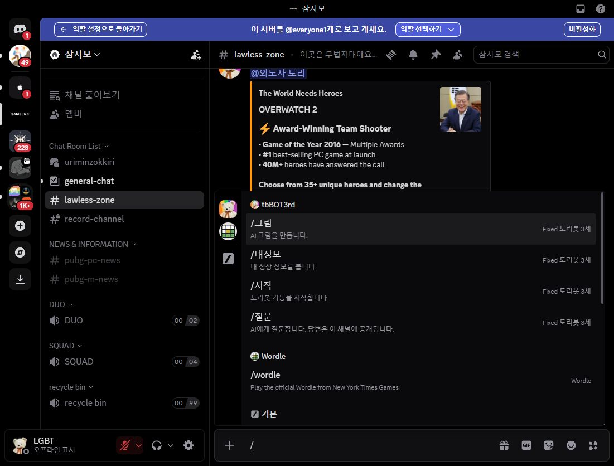

# 지정 채널 전체 권한 점검·삭제 기록 및 프로필 표시 수정 · 2026-10-24 KST

## 실제 Discord 설정 변경

운영자가 지정한 아사모 5개·삼사모 7개 채널을 모두 열어 등록된 역할·회원 우선 설정을 확인했습니다.
대상은 **애플리케이션 명령어 사용**입니다. 일반·운영자 역할과 실제 회원의 남은 거부는 통과로 저장했고,
기존 허용은 유지했습니다. 채널 보기·쓰기·Administrator·역할 배정·타임아웃을 변경하지 않았습니다.
봇 전용 역할과 기존 인증 대기 역할의 제한은 유지합니다. 숨김 채널을 새 회원에게 공개하지 않았습니다.

삼사모의 선행 조정은 서버 기본 @everyone 권한 켜기와 명령별 설정을 포함합니다.
두 서버 모두 일반 네 명령은 @everyone 허용, `/관리`는 @everyone 거부와 기존 두 ID 개별 허용을 유지합니다.
봇 서버 측 관리자 인증을 바꾸거나 Discord Administrator를 지급하지 않았습니다.

### 아사모 · 서버 802904099816472616

| 지정 채널 ID | 채널 | 확인한 역할/회원 설정 수 | 결과 |
| --- | --- | ---: | --- |
| 802904099816472619 | general-chat | 5 | 기존 복구 상태 정상, 추가 변경 없음 |
| 820536422808944662 | game-chat | 5 | @everyone·고인물·맑은물·뉴비 거부 해제 |
| 1176877764608004156 | private-zone | 4 | @everyone·맑은물·회원 stephan3138 거부 해제 |
| 1134766793249013780 | main-chat | 5 | 정상, main channel 카테고리 동기화 유지 |
| 865821307969732648 | moderator-only | 1 | 정상, 추가 변경 없음 |

### 삼사모 · 서버 721047251862159416

| 지정 채널 ID | 채널 | 확인한 역할/회원 설정 수 | 결과 |
| --- | --- | ---: | --- |
| 859476893756293131 | moderator-only | 2 | 정상, 추가 변경 없음 |
| 1247409483353821335 | uriminzokkiri 포럼 | 12 | 일반·운영자 역할 및 나냡 등 회원별 거부 해제 |
| 721047251862159420 | general-chat | 9 | 선행 복구 확인, 최고 관리자 역할의 남은 거부 해제 |
| 929421822787739708 | lawless-zone | 6 | @everyone·평민 및 최고 관리자 역할 거부 해제 |
| 904343326654885939 | nondisclosure-chat | 4 | @everyone·나냡 개인·최고 관리자 거부 해제 |
| 862310554567835658 | revolution-chat | 3 | @everyone·나냡 개인 거부 해제 |
| 915207176518270981 | manage-room | 3 | 최고 관리자 역할 거부 해제 |

합계 **12개 채널, 등록된 역할·회원 우선 설정 59개**를 확인했습니다.
텍스트 채널은 설정별 26개, 포럼은 24개 권한 항목을 읽었고 앱 명령 항목 외 값을 비교했습니다.
저장 후 역할을 재선택해 현재 값도 확인했습니다. 클릭할 항목은 앱 명령 권한에 한정했고 의도치 않은 다른 변경은 발견하지 못했습니다.
전체 권한 동기화/초기화는 사용하지 않았으며 독립 채널과 main-chat의 기존 상속 상태를 보존했습니다.

### 실제 실패 원인과 확인 수준

처음 삼사모 general-chat 조정 후 나냡은 두 명령이 여전히 안 보인다고 보고했습니다.
이후 운영자가 준 진단의 실제 채널은 lawless-zone이었습니다.
그곳에서 **앱 명령 사용 거부 / 도리봇 관리자 인증 허용**이 확인됐습니다.
lawless-zone은 카테고리와 독립된 설정이므로 앞선 카테고리 수정이 적용되지 않았습니다.
포럼·다른 독립 채널의 회원별 거부도 같은 이유로 별도 확인이 필요했습니다.

수정 후 실제 Discord의 `평민 + @everyone` 역할 미리보기로 lawless-zone을 열었습니다.
`/시작`, `/질문`, `/그림`, `/내정보` 네 명령 표시와 `/관리` 미표시를 확인했습니다.
확인용 `/` 초안은 지웠으며 실제 명령이나 채팅을 전송하지 않았습니다.
**나냡 계정 자체의 수정 후 진단·두 명령 표시·실행은 재확인을 요청한 상태**입니다.
일반 역할 미리보기와 실제 지정 계정 검증을 구분합니다. 비공개 채널 접근 자체는 기존 권한을 따릅니다.

## 소스 UI 변경

- `deletion_audit.py`: 제목 `메시지 삭제 기록`, `User: @사용자`, `Channel: #채널`, `Deleted Content`, 서버명·KST footer로 정리했습니다.
  숫자 메시지/채널/작성자/서버 ID 라벨과 미디어 ID 나열은 없앴습니다. 사유·실제 탐지·존재하는 첨부 정보·절삭/캐시 누락 표시는 유지합니다.
- `bot_ui.py`: 타이핑 인사도 검증된 계정 ID의 실제 Discord 멘션을 사용합니다. 닉네임이 바뀌어도 같은 프로필을 열 수 있습니다.
  유효한 ID가 없을 때만 안전한 표시 이름을 사용하며, 입력 객체의 임의 mention 문자열은 신뢰하지 않습니다.
- 프로필/채널 참조는 검증된 숫자 ID로 만들고 `AllowedMentions.none()`으로 알림은 보내지 않습니다.
  원문 속 멘션/Markdown/링크는 기존처럼 무해하게 표시합니다.
- 1개 Components V2 컨테이너, 기존 4개 버튼 ID·콜백·영속 등록, 타이핑 지연·쿨다운은 유지합니다.
  삭제 스냅샷 내부 ID·중복 방지·공개 범위·원문 보존·검열·콘솔 원문 미기록 정책도 유지합니다.
- `main.py`: 운영 상태 안내를 새 카드 표시 방식에 맞췄습니다. Discord 조치 서비스와 AI·XP 동작은 변경하지 않았습니다.

## 검증·배포

- 전체 `python -m unittest discover -s tests -v`: **514개 통과, 실패 0, 스킵 0** (18.522초).
  첫 실행에서는 이전 UI 필드명/표시 이름/ID를 기대하던 통합 테스트가 실패했습니다.
  새 요구에 맞춰 기대값을 갱신하고 원문·규칙·내부 ID·중복·수정 경로 검증을 보존한 뒤 전체 통과를 확인했습니다.
- `python -m compileall -q .`, `git diff --check` 통과. 로컬 Python 3.12.14 / discord.py 2.7.1입니다.
- Discord 권한은 실서버에 저장됐습니다. **새 삭제 카드·타이핑 멘션 UI는 소스 수정 상태이며 Northflank 배포는 수행하지 않았습니다.**
  새 환경변수나 전역 slash sync는 필요하지 않습니다. 기존 토큰·원문 공개 정책을 그대로 두고 커밋을 배포해야 UI가 적용됩니다.
- 배포 후 실제 삭제 카드의 프로필 클릭·원문·첨부 표시, 이름 변경 후 프로필 연결, 타이핑 알림 무핑,
  일반 회원의 네 명령 실행, 두 지정 계정의 `/관리` 진입 및 비허용 계정 거부를 확인해야 합니다.
  12개 채널의 모든 실제 회원 조합·모바일 렌더링·실제 AI 요청은 이번 로컬 테스트가 보증하지 않습니다.

선행 삼사모 설정·변경 전 화면은 [2026-10-23 운영 기록](SLASH_SAMSAMO_ACCESS_OPERATIONS_2026-10-23.md)에 보존했습니다.
