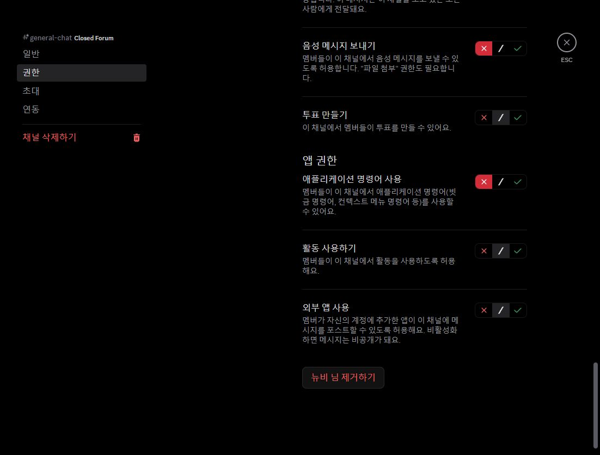
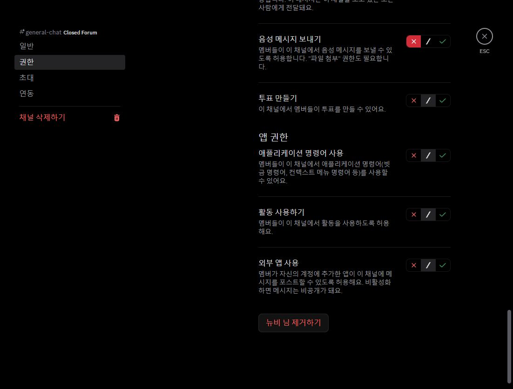
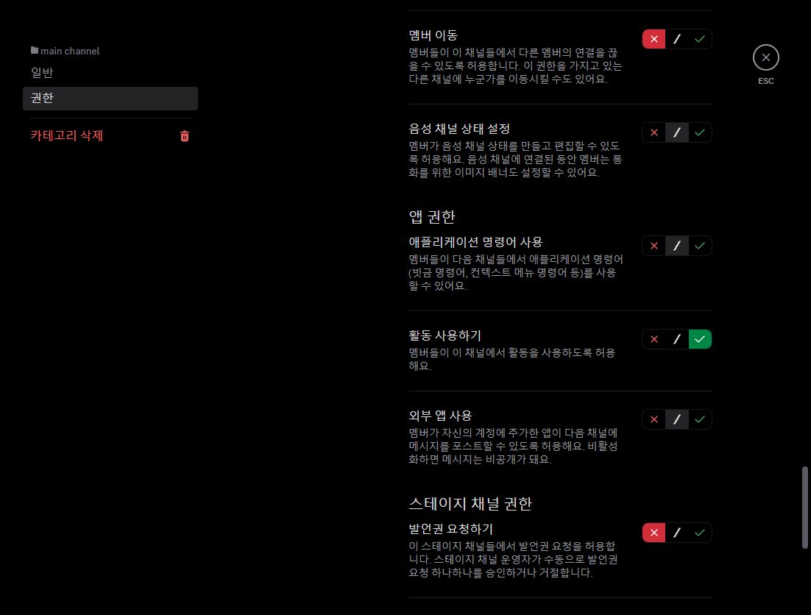
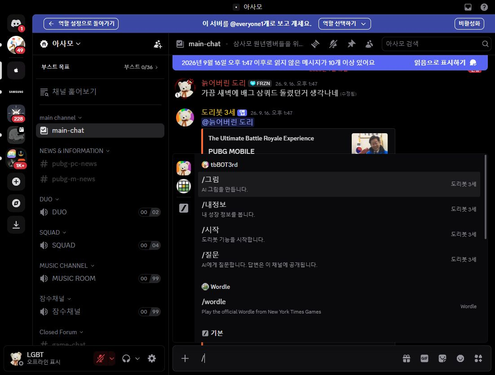

# 슬래시 비표시 후속 수정: 채널·카테고리 거부 해제 · 2026-10-23 KST

변경 전에는 나냡이 Discord를 재시작해도 `/질문`, `/관리` 둘 다 보이지 않는다고 확인했습니다.
따라서 이전 `1d3c587`의 명령별 권한 저장은 장애 해결 완료가 아닙니다.
이번에는 실제 Discord 채널의 고급 권한을 열어 차단 원인을 확인했습니다.

## 변경 전 확인한 실제 설정

서버는 아사모 `802904099816472616`입니다.

| 검사 대상 | 상속 상태 | @everyone | 고인물 | 맑은물 | 뉴비 |
| --- | --- | --- | --- | --- | --- |
| `main channel` 카테고리 | 카테고리 자체 설정 | 명령 사용 거부 | 명령 사용 거부 | 명령 사용 거부 | 명령 사용 거부 |
| `main-chat` (`1134766793249013780`) | `main channel`과 동기화 | 명령 사용 거부 | 명령 사용 거부 | 명령 사용 거부 | 명령 사용 거부 |
| `general-chat` (`802904099816472619`) | `Closed Forum`과 동기화되지 않은 독립 설정 | 명령 사용 거부 | 명령 사용 거부 | 명령 사용 거부 | 명령 사용 거부 |

위 값은 모두 **애플리케이션 명령어 사용** 항목입니다. 고급 권한을 실제로 펼친 뒤 네 역할을 각각 선택해 읽었습니다.
`general-chat`의 비공개 채널 상태도 확인했으며 이를 해제하지 않았습니다.

서버 기본 역할에 같은 권한이 켜져 있어도 채널 거부가 남으면 사용할 수 없습니다.
특별 관리자 ID 설정과 명령별 허용은 채널의 권한 비트를 해제하지 않습니다.
Discord 소유자/Administrator는 채널 거부를 우회하므로 관리자에게만 보이는 현상을 설명합니다.
Wordle처럼 외부 앱의 명령이 남는 것도 서버 설치 앱의 명령 사용 허용을 증명하지 않습니다.
이는 [Discord의 앱 권한 설명](https://support-apps.discord.com/hc/en-us/articles/26501864012951-Moderating-Apps-on-Discord)과
[권한 덮어쓰기 규칙](https://docs.discord.com/developers/topics/permissions#permission-overwrites)에 부합합니다.

## 승인 후 실제 저장·재조회 결과

운영자가 **“이 두 범위의 명령 사용 거부 해제 승인”**이라고 명시한 뒤 아래 범위만 Discord UI에서 저장했습니다.
이전 앱 명령별 권한 승인과 별도로 받은 채널·카테고리 권한 변경 승인입니다.

- `main channel` 카테고리 및 동기화 채널: 네 역할의 앱 명령 사용 `거부 → 통과(서버 권한 상속)`.
- 독립 `general-chat`: 같은 네 역할의 같은 항목만 `거부 → 통과`.
- 서버 기본 역할의 앱 명령 사용은 이미 허용이므로 이 비트의 거부만 제거합니다.
- `main-chat`의 카테고리 동기화를 유지하고, `general-chat`의 독립 설정도 유지합니다.
  `지금 동기화하기`로 다른 권한을 통째로 바꾸지 않습니다.
- 채널 보기·쓰기, 관리자 권한, 다른 앱의 개별 명령 설정, `/관리`의 지정 ID 인증은 변경하지 않습니다.
  이 비트는 도리봇을 포함한 서버 설치 앱의 명령에 적용되므로 그 범위를 승인 질문에 명시했습니다.

네 역할을 각각 변경·저장하고 역할을 다시 선택해 저장값을 재조회했습니다.

| 저장·확인 대상 | @everyone | 고인물 | 맑은물 | 뉴비 | 보존 확인 |
| --- | --- | --- | --- | --- | --- |
| `main channel` 카테고리 | 통과 | 통과 | 통과 | 통과 | 역할별 다른 40개 항목 동일 |
| 동기화된 `main-chat` | 통과 | 통과 | 통과 | 통과 | 카테고리 동기화 유지, 채널 자체 편집 없음 |
| 독립 `general-chat` | 통과 | 통과 | 통과 | 통과 | 역할별 다른 25개 항목 동일, 비공개·독립 설정 유지 |

기존의 일반 네 명령 개별 공개와 `/관리` 두 ID 허용은 유지됩니다.

변경 전 비교를 위해 카테고리 네 역할의 권한 항목 41개씩, 독립 채널 네 역할의 26개씩을 메모리에서 읽었습니다.
저장·재조회 후 각 배열에서 앱 명령 사용 항목만 제외해 비교했으며 **8개 역할 설정 모두 다른 값이 동일**했습니다.
운영 서버의 전체 권한을 장기 상태 파일로 보관하거나 사용자에게 관리 권한을 부여하지 않았습니다.

일반 역할 미리보기의 `main-chat`에서 `/` 선택기에 `/그림`, `/내정보`, `/시작`, `/질문` 네 명령이 나타났습니다.
같은 미리보기 목록에는 `/관리`가 없었습니다. 확인용 `/` 초안은 지웠고 메시지/명령을 전송하지 않았습니다.
계정 재접속 후 실제 나냡 계정에서 두 명령이 보이는지 요청했고, 운영자가 **“두 명령 모두 보입니다”**라고 확인했습니다.
따라서 나냡의 `/질문`·`/관리` 목록 표시 복구는 운영자 확인을 받았습니다.
**실제 두 명령 실행 성공과 모바일 검증은 아직 미확인**이며 표시 복구와 구분합니다.

## 코드·자동 검증

- `slash_access.py`: `!명령진단`에서 실제 앱 명령 사용이 거부일 때 채널/카테고리 고급 권한, 역할/회원 거부,
  명령별 허용의 한계와 소유자/Administrator 예외를 명확하게 안내합니다.
- `tests/test_slash_access.py`: 실제 discord.py `Guild`, `Role`, `Member`, `TextChannel`, `PermissionOverwrite`로 5개 회귀를 추가했습니다.
  기본 허용과 파딱 인증이 있어도 채널/역할 거부가 우선함, everyone 거부만 없애면 역할 거부가 남음,
  해당 권한 비트만 제거하면 다른 권한은 유지됨, 회원 거부의 우선순위, 소유자/관리자 예외를 확인합니다.
- 전체 `python -m unittest discover -s tests -v`: **510개 통과, 실패 0, 스킵 0** (18.321초).
  실행 환경은 로컬 Python 3.12.14 / discord.py 2.7.1입니다.
- `python -m compileall -q .`, `git diff --check` 통과.
- 이번 운영 설정 변경 후 관련 `test_slash_access.py` **19개 재실행 통과, 실패 0, 스킵 0** (0.027초).
  이번 커밋은 운영 기록·화면이며 봇 소스 변경은 없습니다. 전체 510개 결과는 위 선행 코드 변경의 검증입니다.

자동 테스트, 실제 설정 저장, 일반 역할 미리보기, 나냡의 실제 실행 성공은 각각 구분합니다.
Northflank 배포·환경변수·전역 명령 sync·Developer Portal 설치는 변경하지 않았습니다.
설치나 전역 명령을 지우고 다시 만드는 대신 확인된 채널 차단을 먼저 처리합니다.

## 변경 전 화면

`general-chat`의 뉴비 역할: 앱 명령 사용이 거부되어 있습니다.

## 변경 후 화면

`general-chat`과 `main channel`에서 앱 명령 사용이 통과(가운데 `/`)로 저장되어 있습니다.

일반 역할 미리보기의 네 일반 명령 표시입니다. 나냡 계정의 두 명령 표시도 운영자가 확인했으며 실행 검증과 구분합니다.

