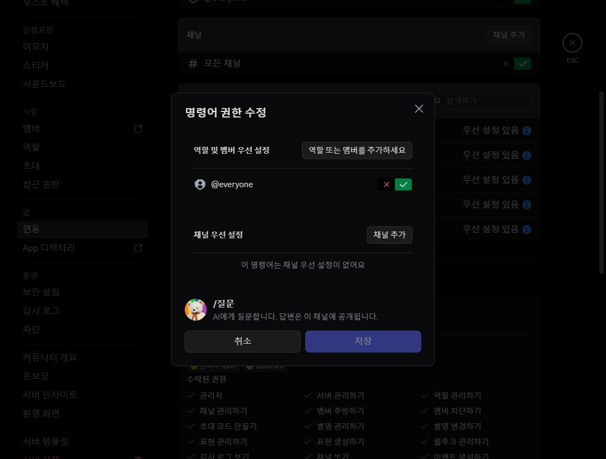
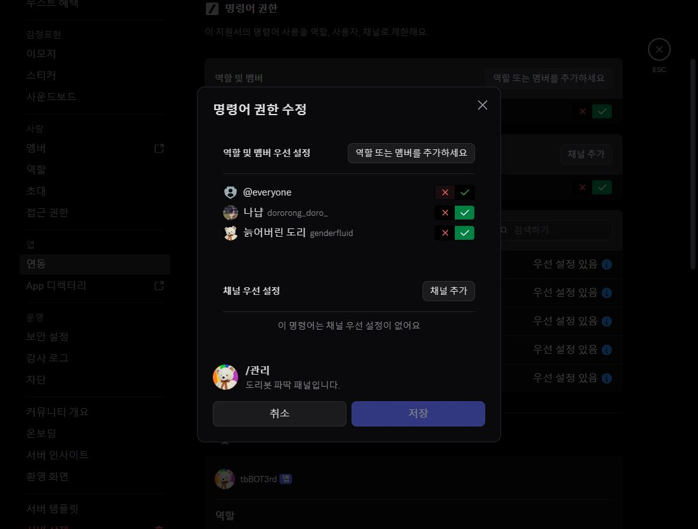

# 아사모 슬래시 명령별 접근 권한 조정 · 2026-10-23 KST

> 후속 확인: 채널 수정 전에는 나냡이 재접속 후에도 두 명령 모두 보이지 않는다고 보고했습니다. 명령별 허용 저장만으로 해결되지 않았으며,
> 실제 채널/카테고리 거부를 추가 확인하고 별도 승인 후 해당 항목만 해제했습니다. 일반 역할 미리보기에서 네 일반 명령 표시를 확인했습니다.
> 운영자도 나냡 계정의 두 명령 표시를 확인했습니다. 실제 실행 검증과 구분한 [후속 저장·검증 결과](SLASH_CHANNEL_PERMISSION_DIAGNOSIS_2026-10-23.md)를 확인하세요.

이 기록은 소스 수정만 수행한 이전 `f2f951e` 작업과 별개인 **실제 Discord 서버 설정 변경**입니다.
운영자가 명령별 권한 저장 범위를 명시적으로 승인한 뒤 브라우저 UI에서 저장하고 각 명령을 다시 열어 확인했습니다.

## 대상과 최종 저장값

- 서버: 아사모 · `802904099816472616`
- 앱: `tbBOT3rd` (서버 표시명 도리봇 3세)
- 신고된 기존 원본 채널: general-chat · `802904099816472619`
- 확인한 공개 채팅 채널: main-chat · `1134766793249013780`

| 명령 | @everyone | 사용자 개별 허용 | 저장 후 재조회 |
| --- | --- | --- | --- |
| `/시작` | 허용 | 없음 | 확인 |
| `/질문` | 허용 | 없음 | 확인 |
| `/그림` | 허용 | 없음 | 확인 |
| `/내정보` | 허용 | 없음 | 확인 |
| `/관리` | 거부 | `491239880005910538` 나냡, `855749166764654653` 늙어버린 도리 | 확인 |

두 계정은 역할 이름이나 표시 이름만으로 추정하지 않고, 권한 대상 선택창에서 각 사용자 ID를 검색해 확인했습니다.
명령별 채널 우선 설정은 추가하지 않았습니다. 앱 전체의 기존 `@everyone 허용`, `모든 채널 허용`도 유지합니다.
서버 역할·카테고리·채널의 권한, 개인 계정 설정, 다른 앱 설정은 변경하지 않았습니다.

## 인증과 보안 범위

Discord의 명령별 권한은 선택기 접근층입니다. 봇의 기존 서버 측 인증은 별개로 그대로 유지합니다.
`/관리` 진입·버튼·메뉴·모달·준비·실제 실행은 서버 소유자 또는 정확히 설정된 파딱 ID를 검사합니다.
Discord 관리자 역할만으로 도리봇 관리 권한을 새로 주지 않습니다.

Discord 서버 소유자/Administrator는 Discord 명령 권한의 예외를 적용받을 수 있으므로,
`@everyone 거부`가 모든 다른 관리자에게 `/관리`를 숨긴다고 보장하지 않습니다.
선택기에 보여도 봇의 서버 측 인증을 통과해야 패널을 사용할 수 있습니다.

일반 네 명령은 일반 회원에게 공개하되 금칙어·링크 검열, AI 한도, 공개 답변 안내 등 기존 실행 정책은 유지합니다.
앱 전체를 파딱 전용으로 막지 않습니다. 서버 범위 제한 환경변수에는 채널 ID가 아닌 실제 서버 ID를 사용합니다.

## 실제 확인과 남은 검증

확인한 사실:

- 앱 설정에 다섯 명령이 게시되어 있습니다. 로딩 직후 잠깐 나타난 `명령어 없음`을 최종 게시 결과로 판단하지 않았습니다.
- 앱 전체 `@everyone`/모든 채널 허용과 기본 역할의 애플리케이션 명령어 사용이 켜져 있었습니다.
- 일반 네 명령의 개별 `@everyone 허용`과 `/관리`의 거부/두 계정 허용을 저장 후 재조회했습니다.
- 관리자 계정의 실제 채팅 선택기에서 도리봇 다섯 명령이 표시되는 것을 확인했습니다.

아직 확인하지 못한 사실:

- 나냡과 일반 계정이 재접속 후 실제 선택기에서 명령을 보고 실행하는지.
- 나냡의 `/관리` 패널 진입과 비허용 계정의 서버 측 비공개 거부가 실서버에서 동작하는지.
- 일반 역할의 서버 미리보기에서는 변경 전후 모두 Wordle/기본 명령만 나타났습니다.
  이는 실제 일반 계정의 실행 성공 증거가 아니며, 미리보기만으로 장애 원인이나 복구 성공을 확정하지 않습니다.
- 모든 역할 조합·채널 오버라이드와 모바일 클라이언트의 표시 여부.

나냡 계정에 Discord 완전 종료·재실행 후 `/질문`, `/관리` 목록 확인을 요청했습니다.
저장 성공과 전체 사용자 복구 성공은 구분합니다. 아직 안 보이면 해당 계정의 `!명령진단` 결과와 실제 채널/역할 제한을 추가 확인해야 합니다.
새로운 `Administrator` 역할을 주거나 다른 서버/앱의 권한을 풀어 해결하지 않습니다.

## 코드·배포와 검증

이번 작업은 Discord 명령별 설정 변경과 운영 기록만 포함합니다. 봇 소스·저장 데이터·AI·검열·XP·타이핑 콜백은 수정하지 않았습니다.
Northflank 환경변수, 배포, Developer Portal 설치, 글로벌/길드 명령 동기화는 수행하지 않았습니다.
변경한 것은 이 서버의 명령 권한이며 소스 코드 커밋이나 새 `sync`만으로 다른 서버에도 자동 적용되는 설정이 아닙니다.
회귀 테스트는 `python -m unittest discover -s tests -v` **505개 통과, 실패 0, 스킵 0** (20.091초),
`python -m compileall -q .`와 `git diff --check` 통과입니다. 실행 환경은 로컬 Python 3.12.14 / discord.py 2.7.1입니다.
단위 테스트는 Discord 설정의 실제 전파·계정별 실행을 보장하지 않습니다.

## 저장 후 증거

일반 명령 공개(`/질문`):

`/관리`의 전체 회원 거부 및 두 지정 계정 허용:

참고: [Discord 명령 권한](https://docs.discord.com/developers/interactions/application-commands#permissions),
[서버를 역할로 보기](https://support.discord.com/hc/en-us/articles/360055709773-View-Server-As-Role-Permission-Guide).
