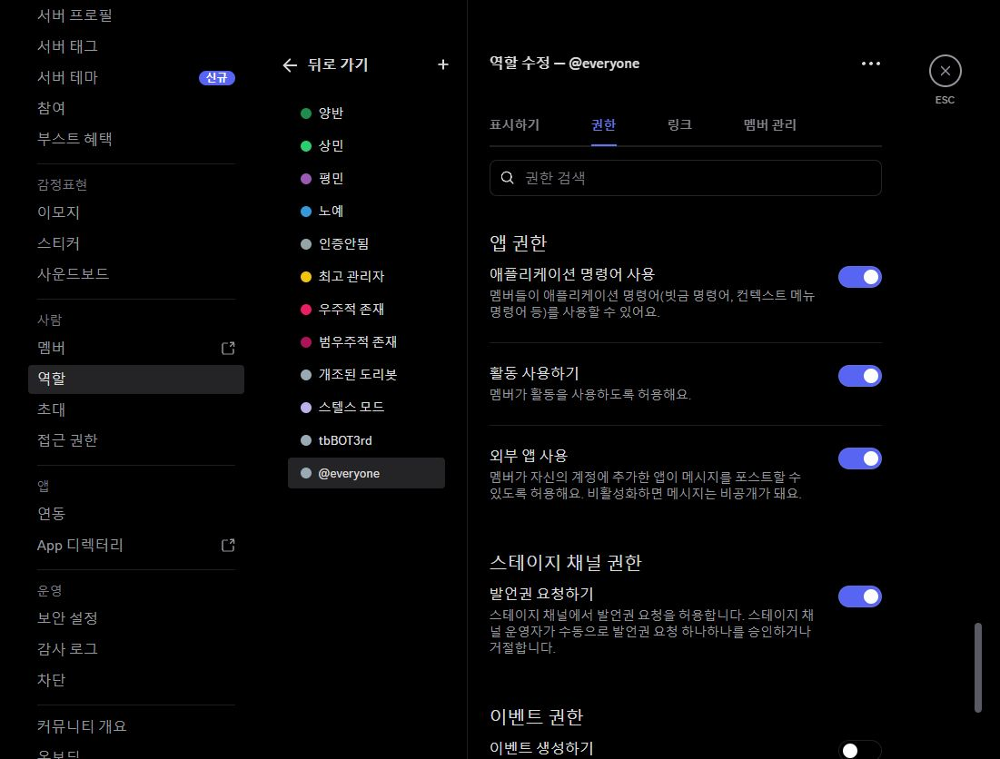
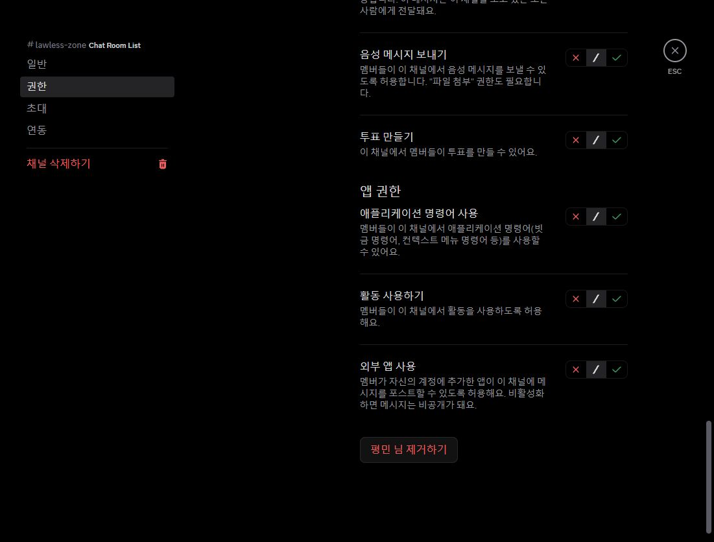

# 삼사모 lawless-zone 거부 보고 후속 진단 · 2026-10-24 KST

앞선 **여전히 거부** 보고 후, 운영자가 같은 서버·같은 lawless-zone에서 나냡의 새 진단 본문을 제공했습니다.
최신 결과는 **앱 명령 사용 허용·도리봇 관리자 인증 허용**입니다. 해당 채널에서 보고됐던 권한 거부의 해소는 확인됐습니다.
실제 슬래시 선택기 표시·명령 실행 성공은 아직 별도 확인 대상입니다.

## 최신 실제 계정 진단 · 운영자 제공

| 항목 | 최신 결과 |
| --- | --- |
| 서버 ID | 721047251862159416 |
| 채널 ID | 929421822787739708 |
| 나냡 채널 보기 | 허용 |
| 나냡 앱 명령 사용 | 허용 |
| 봇 채널 보기·메시지 전송 | 허용 |
| 도리봇 /관리 인증 | 허용 |

이번 확인은 운영자가 제공한 실제 계정의 진단 결과에 근거합니다.
본문에는 진단 v2·새 조회 비교·검사 시각이 없으므로 진단 v2 배포나 실제 REST 비교 실행을 확인한 것으로 기록하지 않습니다.
이전 거부가 현재 허용으로 바뀐 정확한 시점과 캐시/전파 여부는 미확정입니다.

## 새로 확인한 Discord 저장값

Discord 페이지를 새로 불러온 뒤 설정을 다시 열었습니다. 추가 권한 변경은 하지 않았습니다.

- 서버: 삼사모 `721047251862159416`.
- 서버 기본 @everyone의 **애플리케이션 명령어 사용: 켜짐**.
- lawless-zone `929421822787739708`: 카테고리와 독립된 설정.
- 상민·노예: 앱 명령 사용 허용.
- @everyone·평민·최고 관리자: 통과.
- 우주적 존재: 기존 봇 전용 역할 거부 유지.
- 이 채널의 회원별 우선 설정은 없습니다.

앞서 실제 나냡 회원 정보에서는 평민 역할을 확인했습니다.
평민+@everyone 미리보기는 일반 네 명령을 표시했지만 나냡 계정 자체의 실행을 검증하지는 못합니다.
새 진단의 전체 본문·검사 시각·실제 명령 목록 상태를 요청했고, 이후 위 허용 결과를 받았습니다.
본문만으로 캐시가 실제로 오래됐는지 또는 이전 검사가 저장 전이었는지를 단정하지 않습니다.

## 진단 코드 보완

`!명령진단`은 기존에 Gateway 캐시의 `channel.permissions_for`만 표시했습니다.
새 진단은 버전·KST 검사 시각·공개된 응답 봇 ID를 함께 보여 줍니다.
현재 본인/현재 채널의 캐시 결과가 거부이면 Discord에서 역할·본인 회원·채널을 읽기 전용으로 새로 조회합니다.
스레드의 경우 부모 권한을 별도로 조회하고, 설치된 discord.py의 권한 계산을 격리된 사본에 적용합니다.

- 새 조회는 전체 4초 제한, 동시 2건 제한과 기존 본인·서버별 60초 쿨다운을 적용합니다.
- 다른 회원/다른 서버 조회, 권한 쓰기, 역할 배정, 전역 명령 sync, 실제 Gateway 캐시 변경을 하지 않습니다.
- 새 조회는 서버 기본·보유 역할·채널 공통·역할/회원 우선 설정·타임아웃을 요약하며 이름이나 개인 ID를 나열하지 않습니다.
- Forbidden/NotFound/HTTP/시간 초과는 고정 코드로 표시하며 API 예외 본문·토큰·환경변수를 출력하지 않습니다.
- 캐시 거부/새 조회 허용은 캐시와 현재 조회가 다르다는 증거입니다. 실제 선택기·명령 실행 복구를 보장하지 않습니다.
- 새 조회도 거부이면 표시된 적용 계층을 근거로 원인을 좁힙니다. 조회 실패는 허용으로 간주하지 않습니다.
- 새 조회에 성공하면 캐시 기준의 채널 거부 해제 지시는 제거합니다. 타임아웃·보기·기본 권한 제한을 근거 없이 채널 권한 확대로 우회하도록 안내하지 않습니다.
- 연동 명령별 권한·원격 게시·클라이언트 캐시는 이 조회와 별도입니다.
- 새로 읽는 범위는 역할·회원·채널입니다. 서버 소유자 변경 여부 자체는 기존 길드 정보에 의존하므로 전체 서버 상태를 새로 조회했다고 표현하지 않습니다.

진단 v2의 실서비스 배포·실제 REST 비교 검증은 미확인입니다. 위 권한 거부 해소 확인과 진단 v2 경로 검증을 구분합니다.
실제 `/질문`·`/관리`의 선택기 표시 및 실행, 모바일 확인도 아직 미확인입니다.
Northflank 환경변수·프로세스·Discord 실제 권한은 이번 후속 조사에서 바꾸지 않았습니다.

## 수정 파일·검증

- `slash_access.py`: 제한된 새 조회·사본 계산·권한 단계 및 응답 식별 정보.
- `main.py`: 기존 진단 명령에서 비동기 새 조회 진단을 호출. 기존 쿨다운·알림 차단·90초 삭제 유지.
- `tests/test_slash_access.py`, `tests/test_slash_access_integration.py`: 신규 15개 회귀 및 실제 명령 어댑터 연결 검증.
  캐시/새 조회 불일치, 회원 거부·타임아웃·보기 제한, 격리 사본, 잘못된 범위, API 오류·취소·시간 제한·동시성·스레드 부모를 확인합니다.
- 관련 테스트 **39개 통과**, 전체 `python -m unittest discover -s tests -v` **529개 통과**, 실패 0, 스킵 0 (18.759초).
- `python -m compileall -q .`, `git diff --check` 통과. 로컬 Python 3.12.14 / discord.py 2.7.1입니다.
- 테스트의 REST 응답은 모의 객체이며 실제 운영 API·나냡 계정·선택기 검증을 대신하지 않습니다.
- 최신 허용 결과를 반영한 이번 변경은 문서만 수정했습니다. 선행 코드의 전체 테스트 결과는 유지하며 `git diff --check`를 다시 확인합니다.

관련 선행 결과: [12개 채널 권한·UI 수정](CHANNEL_ACCESS_AND_COMPACT_UI_2026-10-24.md).
