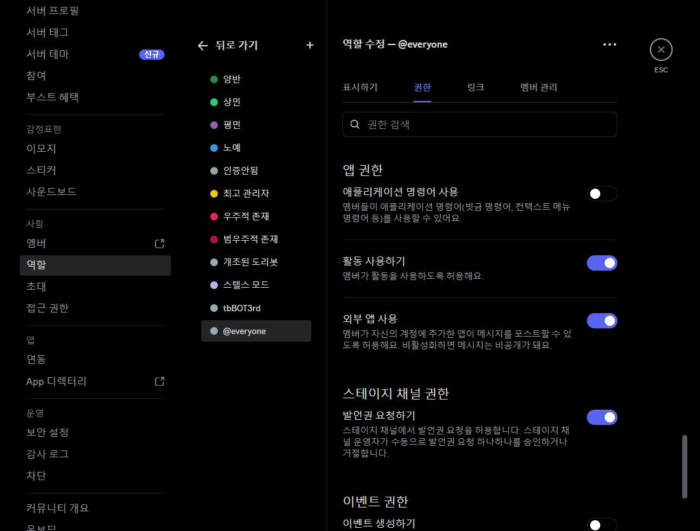
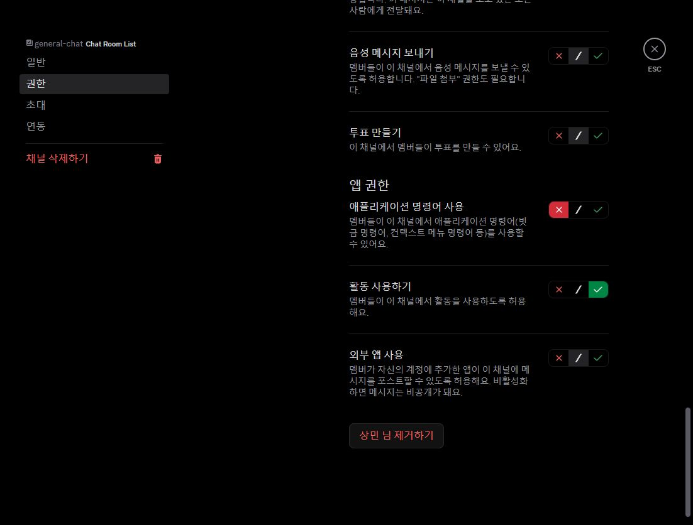
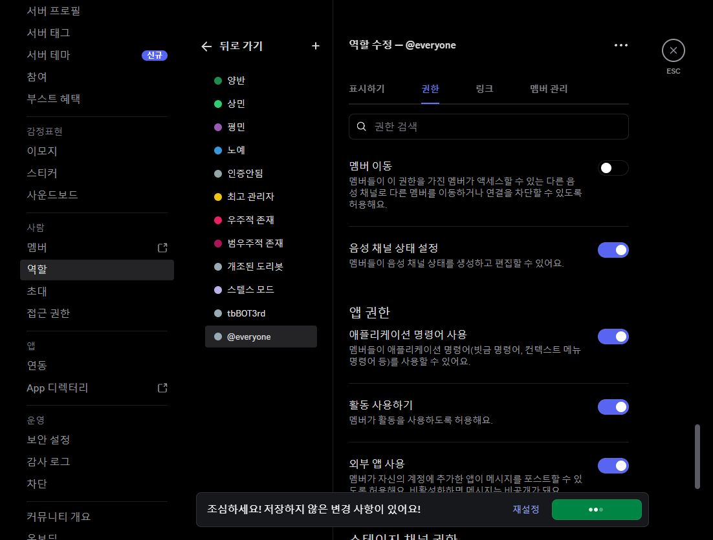
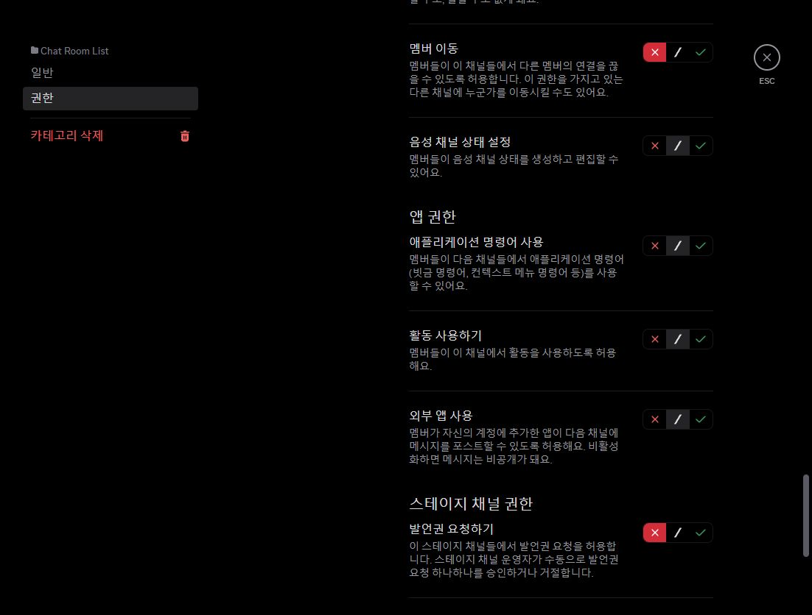
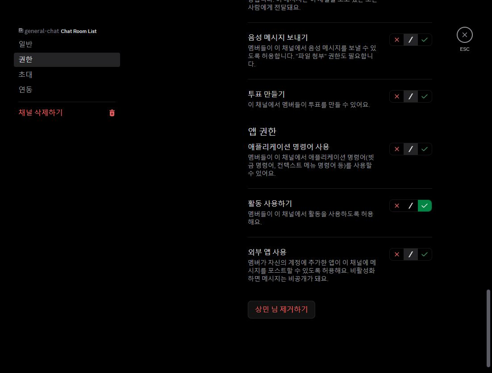
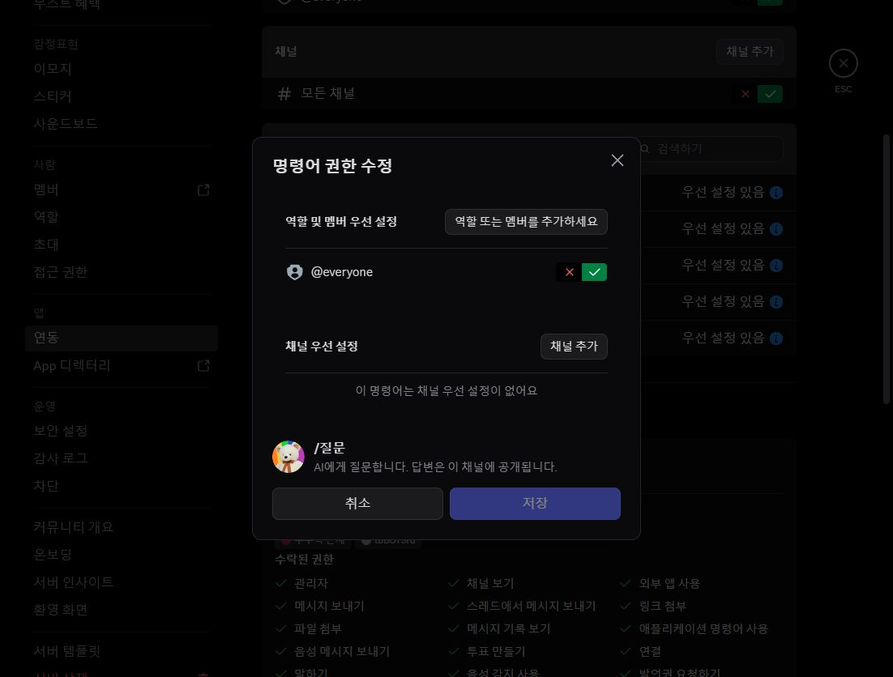
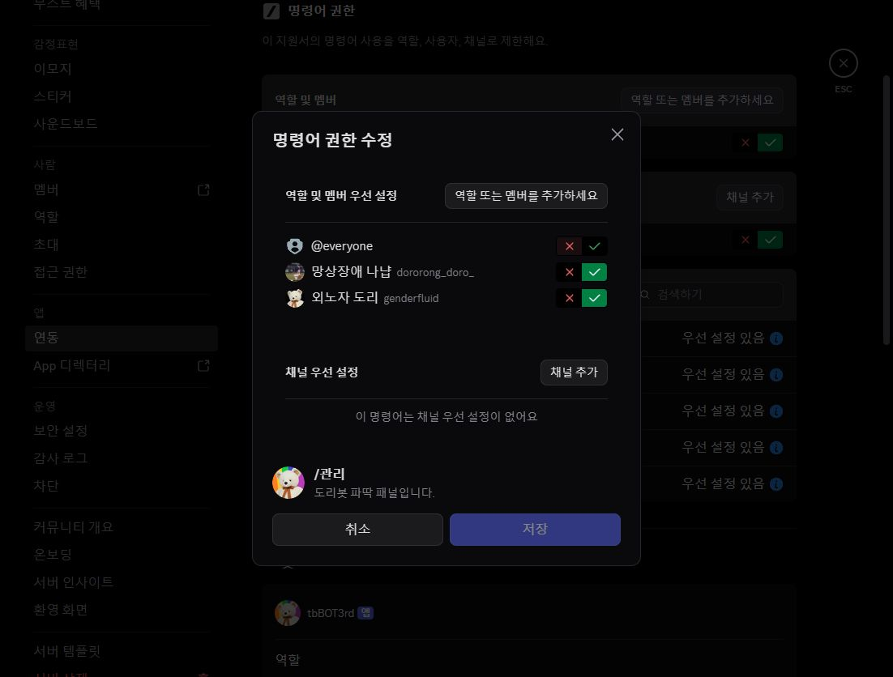
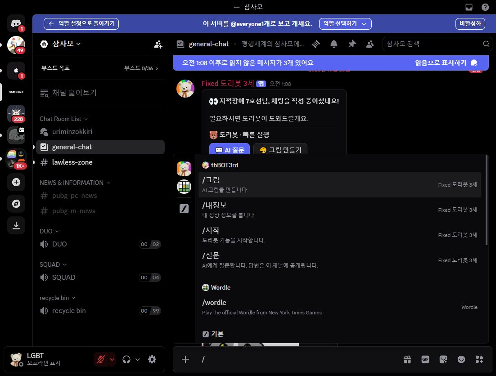

# 삼사모 슬래시 접근 권한 적용 · 2026-10-23 KST

> 후속: 나냡이 실제 확인한 lawless-zone의 독립 설정에서 거부가 남아 있었습니다.
> 2026-10-24에는 별도 승인 및 전체 지정 채널 작업 요청에 따라 12개 채널의 역할·회원별 거부까지 점검·수정했습니다.
> 최신 상태는 [전체 채널·UI 수정 기록](CHANNEL_ACCESS_AND_COMPACT_UI_2026-10-24.md)을 확인하세요.

운영자가 아사모에서 복구한 슬래시 접근 정책을 삼사모에도 적용하도록 요청했습니다.
이 기록은 삼사모 실서버 UI 조회·저장·검증 결과이며 아사모 설정 기록과 구분합니다.

## 대상과 변경 전 상태

- 서버: 삼사모 `721047251862159416`.
- 일반 채팅: `general-chat` `721047251862159420`.
- 부모 카테고리: `Chat Room List`. `general-chat`은 부모와 동기화되지 않은 독립 설정입니다.
- 기존 삭제 로그 목적지 `1065283543640576103`은 채널 ID이며 서버 ID가 아닙니다. 로그 라우팅은 변경하지 않습니다.
- 앱 `tbBOT3rd`의 앱 전체 `@everyone`, `모든 채널`은 이미 허용입니다. 다섯 명령도 표시됩니다.
  목록에는 개별 명령의 우선 설정 표시가 없었고, `/질문` 창에서 회원·채널 우선 설정 없음을 확인했습니다.
- 서버 기본 `@everyone`의 **애플리케이션 명령어 사용은 꺼져 있습니다**.
  채널 거부를 통과로 바꾸는 것만으로는 이 기본 권한을 복구할 수 없습니다.

| 역할 | Chat Room List | 독립 general-chat |
| --- | --- | --- |
| @everyone | 거부 | 거부 |
| 양반 | 허용 | 허용 |
| 상민 | 거부 | 거부 |
| 평민 | 거부 | 거부 |
| 노예 | 거부 | 거부 |
| 인증안됨 | 거부 | 거부 |
| 최고 관리자 | 허용 | 거부 |
| 우주적 존재 | 거부 | 거부 |
| 개조된 도리봇#6286 회원 우선 설정 | 해당 설정 없음 | 허용 |

위 표는 앱 명령 사용 항목만 나타냅니다. 다른 권한이나 인증안됨 역할의 제한을 자동으로 복제·초기화하지 않습니다.
변경 전 서버 기본 권한 51개, 카테고리 역할별 41개, 일반 채널 역할/회원별 26개를 메모리에 읽었습니다.
운영 서버의 전체 권한이나 비밀 환경변수는 상태 파일에 저장하지 않았습니다.

## 승인 후 실제 저장·재조회 결과

서버 기본 권한까지 변경해야 하므로 저장 직전 아래 범위를 제시했고, 운영자가 **“이 범위의 저장 승인”**이라고 확인한 뒤 적용했습니다.

1. 서버 기본 @everyone의 앱 명령 사용 켜기.
2. Chat Room List 및 독립 general-chat에서 @everyone·상민·평민·노예의 해당 항목만 거부에서 통과로 변경.
3. 일반 네 명령에 @everyone 허용, `/관리`에 @everyone 거부와 기존 두 ID `855749166764654653`·`491239880005910538` 허용.

| 저장 대상 | 변경 전 → 저장 후 | 재조회·비교 |
| --- | --- | --- |
| 서버 기본 @everyone 앱 명령 사용 | 꺼짐 → 켜짐 | 스위치 켜짐 확인, 다른 50개 스위치 동일 |
| Chat Room List의 @everyone·상민·평민·노예 | 각 거부 → 통과 | 역할별 41개 항목 중 다른 40개 동일 |
| 독립 general-chat의 같은 네 역할 | 각 거부 → 통과 | 역할별 26개 항목 중 다른 25개 동일 |
| `/시작`·`/질문`·`/그림`·`/내정보` | 앱 설정 상속 → 개별 @everyone 허용 | 네 명령 모두 저장 후 다시 열어 허용 확인 |
| `/관리` | 앱 설정 상속 → @everyone 거부, 두 지정 ID 허용 | 저장 후 다시 열어 세 항목 확인 |

두 지정 계정은 표시 이름만으로 추측하지 않고 사용자 ID를 각각 검색해 선택했습니다.
`491239880005910538`은 나냡, `855749166764654653`은 `genderfluid` 계정으로 확인됐습니다.
명령별 채널 우선 설정은 추가하지 않았고, 앱 전체의 @everyone·모든 채널 허용도 유지했습니다.

카테고리의 8개 역할과 독립 채널의 8개 역할·1개 회원 우선 설정을 모두 재조회했습니다.
변경한 네 역할 이외의 **양반·인증안됨·최고 관리자·우주적 존재 및 기존 회원 우선 설정은 전체 항목이 동일**했습니다.
인증안됨 역할의 앱 명령 사용 거부는 유지합니다. 이 역할 보유자의 최종 권한은 다른 보유 역할·회원 설정도 함께 적용되므로 역할 하나만으로 단정하지 않습니다.
채널 보기·쓰기, 관리자 권한을 변경하지 않았고 general-chat은 여전히 부모와 동기화되지 않은 독립 설정입니다.
전체 동기화나 권한 초기화는 수행하지 않았습니다.

서버 측 기존 파딱 ID 인증은 유지합니다. `SPECIAL_ADMIN_GUILD_IDS`가 실제로 설정돼 있다면 서버 ID 포함 여부는 별도 인증 점검 대상입니다.
Northflank 실제 환경변수 조회·변경, 전역 명령 sync, 봇 재설치는 수행하지 않았습니다.

## 검증

- 실제 Discord 역할 미리보기에서 선택된 역할이 `상민 + @everyone`임을 메뉴로 확인했습니다.
  `general-chat`의 `/` 선택기에 `/그림`, `/내정보`, `/시작`, `/질문` 네 명령이 표시됐고 `/관리`는 표시되지 않았습니다.
  목록 로드가 끝난 뒤 화면을 저장했습니다. 확인용 `/` 초안은 지웠고 메시지나 명령을 전송하지 않았습니다.
- 실제 나냡 계정에서 두 명령이 보이는지 운영자에게 요청했습니다. **나냡의 실제 표시·실행, 다른 회원 및 모바일 검증은 아직 미확인**입니다.
- `python -m unittest discover -s tests -p test_slash_access.py -v`: **19개 통과**, 실패 0, 스킵 0 (0.025초).
  로컬 Python 3.12.14 / discord.py 2.7.1에서 기존 관리자 인증과 실제 권한 덮어쓰기 회귀를 확인했습니다.
- 이번 저장은 Discord 운영 설정 변경이며 봇 소스 변경은 없습니다. 자동 테스트와 일반 역할 미리보기는 실제 지정 사용자 실행을 대신하지 않습니다.
- 후속 확인: 나냡은 두 명령 표시 및 `/관리` 인증, 일반 회원은 네 일반 명령 실행과 `/관리` 거부를 확인합니다.
  표시되지만 `/관리` 인증이 거부되면 채널 권한과 별개로 해당 서버 범위 설정을 점검합니다.

## 변경 전 화면

## 변경 후 화면

